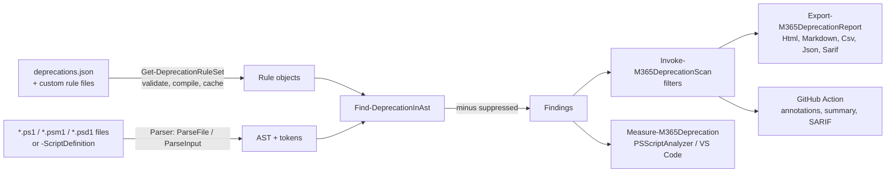

# How it works

This page is for contributors and for anyone who wants to know why the scanner reports what it reports.

## The short version

1. Load the rule database (JSON) and compile the patterns. Cached.
2. Parse each script with the PowerShell parser. Nothing is executed.
3. Walk the syntax tree once per rule kind and match rules.
4. Drop suppressed findings.
5. Apply the user's filters.
6. Hand the findings to the caller: console, report, PSScriptAnalyzer or GitHub Action.

## Parsing, not running

Scripts are parsed with `System.Management.Automation.Language.Parser` (`ParseFile` for files, `ParseInput` for `-ScriptDefinition`). The parser builds an abstract syntax tree (AST) and a token list. No code runs, no module is loaded, no connection is made.

That is why the scanner is safe to run on untrusted scripts and works without MSOnline, AzureAD or any other module installed. `tests/Security.Tests.ps1` checks this, including `using module` pointing at a hostile module.

Other safeguards for untrusted input (for example pull requests):

- Symbolic links found while walking a folder are skipped, and reports are never written through a symbolic link.
- Warnings that quote scanned code are kept on one line, and the GitHub Action pauses workflow-command processing while it scans, so file content cannot inject `::commands::` into the CI log.
- Reports escape everything: HTML encoding plus a strict Content-Security-Policy, backslash-escaped Markdown, and CSV cells that would start a spreadsheet formula get a leading `'`.

The trade-off: only what is written literally can be found. `& $commandName` or `Import-Module $moduleName` cannot be resolved statically and are skipped.

### Parse errors

Files with syntax errors are still scanned. The parser recovers as far as it can, and the scanner writes a warning that results may be incomplete.

One parse error is ignored on purpose: `ModuleNotFoundDuringParse`. `using module MSOnline` produces it when MSOnline is not installed. That is exactly the situation the scanner is built for, so a warning would only be noise.

## Rule kinds and the AST walk

`Find-DeprecationInAst` (in `Private/Find-DeprecationInAst.ps1`) looks at four things:

| Kind | AST nodes | Notes |
|---|---|---|
| `Command` | `CommandAst` | Uses `GetCommandName()`. A module qualifier is stripped: `MSOnline\Get-MsolUser` matches `Get-MsolUser`. |
| `Parameter` | `CommandParameterAst` inside a `CommandAst` | Both the command (`command`) and the parameter name (`pattern`) must match. `-Switch:$false` is not reported. |
| `Module` | `CommandAst` of `Import-Module`, `Install-Module`, `Update-Module`, `Save-Module`, `Install-PSResource`, `Update-PSResource`, `Save-PSResource`; `UsingStatementAst` (`using module`); `ScriptRequirements` (`#Requires -Modules`); top-level `HashtableAst` keys `RequiredModules` / `NestedModules` (module manifests) and the same parameters of `New-ModuleManifest` / `Update-ModuleManifest` | Module names come from `-Name`, `-Name:`, the first positional argument, a list or `@(...)`. Only string constants count. Manifest entries can be strings or `@{ ModuleName = ... }` specifications. A hashtable only counts as a manifest when it stands alone at the top level of the file, so ordinary hashtables in scripts are never mistaken for one. Not found: aliases (`ipmo`), splatting and module paths. |
| `StringLiteral` | `StringConstantExpressionAst`, `ExpandableStringExpressionAst` | .NET regex, case-insensitive, 1 second timeout per match. The command name itself is skipped, and strings nested inside an expandable string are reported once, via the outer string. |

Comments are tokens, not AST nodes, so they never produce findings.

The tree is walked **once** (`Ast.FindAll` with one predicate) and the nodes are sorted by type, because the predicate runs for every node. Name rules are looked up through an index (`New-RuleIndex`): exact names in a case-insensitive dictionary, wildcards as pre-compiled `WildcardPattern` objects. Most commands (`Get-ChildItem`, `Where-Object`, ...) match nothing and leave through an inline fast path. A typical admin script scans in about 100 ms.

Name matching (`Command`, `Parameter`, `Module`) is case-insensitive and supports `*` and `?` wildcards.

The same rule never reports the same position twice. Findings are returned sorted by position in the file.

## Exact rules beat catch-alls

A typical area has one exact rule per important command plus one wildcard catch-all, for example `Get-MsolUser` and `*-Msol*`. `Select-MatchingRule` picks **one** rule per name:

1. An exact (non-wildcard) match wins immediately.
2. Otherwise, among matching wildcard rules, the **longest pattern** wins. It is considered the most specific.
3. A name listed in a rule's `exclude` never matches that rule (for example `Enable-AzureRmAlias` and the `*-AzureRm*` catch-all).

So `Get-MsolUser` gets the rule with the precise replacement, and `Get-MsolSomethingRare` still gets the catch-all.

This applies to `Command` and `Module` rules. `Parameter` and `StringLiteral` rules are independent: each matching rule reports.

## Filters come after matching

`-MinimumSeverity`, `-Area` and `-ExcludeRuleId` are applied to the **findings**, not to the rule list.

Why: if `-ExcludeRuleId` removed the exact `Get-MsolUser` rule before matching, the `*-Msol*` catch-all would match instead and the user would see the same line again under a different id. Matching with all rules and filtering afterwards means "exclude" really excludes.

The PSScriptAnalyzer rule has no filters. Use PSScriptAnalyzer's own settings (`Severity`, `ExcludeRules`) or suppressions there.

## Suppression

`Get-SuppressionMap` (in `Private/Suppression.ps1`) reads the comment tokens once per file and builds a map:

- `m365ds-ignore-file[: ids]` adds ids for the whole file.
- `m365ds-ignore-next-line[: ids]` adds ids for the line after the comment ends.
- `m365ds-ignore[: ids]` adds ids for the line the comment starts on.

No ids means `*` (all rules). Ids are compared upper-case. A finding is checked against the line where it starts. See [suppressions.md](suppressions.md) for the user view.

## Rule database and cache

`Get-DeprecationRuleSet` loads each JSON file, checks the required fields and the kind and status values, and pre-compiles:

- `Severity` from `status` (Retired = Error, Deprecated = Warning, Announced = Information),
- `IsWildcard` for name rules,
- a compiled `Regex` for `StringLiteral` rules.

Results are cached per file in the module scope and reloaded when the file's last write time changes. This matters for PSScriptAnalyzer, which calls the rule for every file and on every keystroke in VS Code.

Duplicate ids across all loaded files stop the scan with an error.

## One engine, three front ends

| Front end | File | What it adds |
|---|---|---|
| `Invoke-M365DeprecationScan` | `Public/Invoke-M365DeprecationScan.ps1` | File discovery (`-Path`, `-Recurse`, `-Include`, `-Exclude`), custom rules, filters |
| PSScriptAnalyzer rule | `Rules/M365DeprecationScanner.Rules.psm1` | Converts findings into `DiagnosticRecord`s. Message is prefixed with `[RuleId]`, `RuleSuppressionID` is the rule id. Uses the built-in rules only. |
| GitHub Action | `action.yml`, `action/Invoke-Action.ps1` | Reads inputs from environment variables, calls the module, writes annotations, job summary, SARIF, HTML, outputs and the exit code |

The PSScriptAnalyzer rule module dot-sources the same `Private/*.ps1` files as the main module, so both always behave the same. A test (`tests/AnalyzerRule.Tests.ps1`) checks that they report identical findings.

## Where to start reading

| Want to change ... | Look at |
|---|---|
| What is matched | `Private/Find-DeprecationInAst.ps1`, `Private/Select-MatchingRule.ps1` |
| Rule loading and validation | `Private/Get-DeprecationRuleSet.ps1`, `Data/deprecations.schema.json` |
| The finding object | `Private/New-DeprecationFinding.ps1`, `M365DeprecationScanner.Format.ps1xml` |
| Reports | `Private/Reports.ps1` |
| File discovery | `Private/Get-ScanTarget.ps1` |

All paths are relative to `src/M365DeprecationScanner/`. Tests live in `tests/`. Setup and conventions: [CONTRIBUTING.md](../CONTRIBUTING.md).
